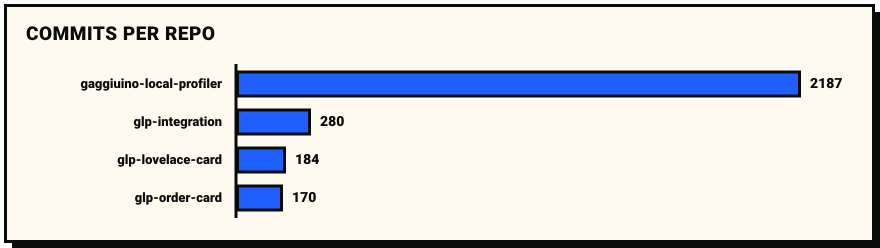
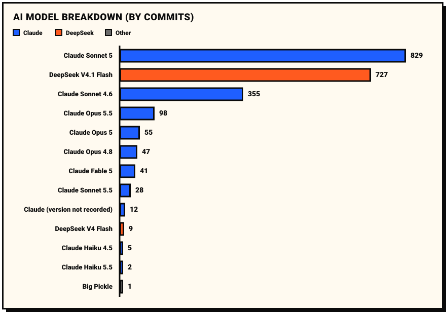

# Development Stats

Generated 2026-10-23 by `scripts/dev-stats.mts`. Re-run it any time to refresh these numbers — they are computed live from git history, not hand-maintained.

## Timeline

The GLP ecosystem (this app + 3 companion repos) has been in development since **2026-05-20** — **155 days** as of the last commit (2026-10-21).

| Repo | First commit | Last commit | Commits | AI co-authored |
|---|---|---|---|---|
| gaggiuino-local-profiler | 2026-05-20 | 2026-10-21 | 2061 | 1639 (80%) |
| glp-integration | 2026-05-22 | 2026-10-20 | 239 | 171 (72%) |
| glp-lovelace-card | 2026-05-24 | 2026-10-20 | 183 | 131 (72%) |
| glp-order-card | 2026-05-25 | 2026-10-20 | 169 | 119 (70%) |
| **Combined** | **2026-05-20** | **2026-10-21** | **2652** | **2060 (78%)** |

<picture>
  <source media="(prefers-color-scheme: dark)" srcset="docs/dev-stats/commits-per-repo-dark.svg">
  
</picture>

Combined line changes (insertions + deletions across all commits): **780.305**, of which **708.760** landed in AI-co-authored commits.

Commits without an AI co-author line are presumed human-only (manual fixes, merges, config tweaks) — not independently verified.

## Hours of development (lower-bound estimate)

Clustering each repo's commit timestamps into working sessions — commits within 2h of each other join the same session, and each session gets a 30-minute lead-in credited ahead of its first commit — gives a combined **711.7 hours** across all four repos.

| Repo | Hours (session-clustered) |
|---|---|
| gaggiuino-local-profiler | 487.3 |
| glp-integration | 86.0 |
| glp-lovelace-card | 71.9 |
| glp-order-card | 66.6 |
| **Combined** | **711.7** |

This is a **lower-bound estimate derived from git commit timestamps only**, not measured time — it undercounts real work because a long AI-agentic session (orchestration, agent dispatch, review between infrequent commits) can run for hours between commits.

## AI model breakdown (by commit co-author line)

| Model | Commits |
|---|---|
| Claude Sonnet 5 | 829 |
| DeepSeek V4.1 Flash | 612 |
| Claude Sonnet 4.6 | 355 |
| Claude Opus 5.5 | 76 |
| Claude Opus 5 | 55 |
| Claude Opus 4.8 | 47 |
| Claude Fable 5 | 41 |
| Claude Sonnet 5.5 | 18 |
| Claude (version not recorded) | 12 |
| DeepSeek V4 Flash | 9 |
| Claude Haiku 4.5 | 4 |
| Claude Haiku 5.5 | 1 |
| Big Pickle | 1 |

<picture>
  <source media="(prefers-color-scheme: dark)" srcset="docs/dev-stats/model-breakdown-dark.svg">
  
</picture>

The exact co-author string varies by era as model names changed over the project's lifetime — this table groups by the literal string used in each commit, so the same underlying model released under a new name shows up as a separate row.

## Cost

The maintainer pays a flat **$20/month** for Claude Pro, regardless of usage volume — this is the actual subscription cost, not a token-usage estimate. Counting every calendar month touched since the first commit (2026-05-20), 6 months works out to **$120.00** for every Claude-model commit combined, regardless of which Claude model did the work.

This assumes a continuous subscription for the whole span — it does not account for any gaps where the subscription might have lapsed.

| Model | Commits | Cost |
|---|---|---|
| DeepSeek V4.1 Flash | 612 | not tracked |
| DeepSeek V4 Flash | 9 | not tracked |
| Big Pickle | 1 | not tracked |

These models are billed per API usage, not a flat subscription, so no dollar figure is derivable from git history alone — no commit yet reports its own cost via a `Co-Authored-Cost-Usd` trailer.

---
*This file is generated. Do not hand-edit — re-run `node scripts/dev-stats.mts` instead.*
